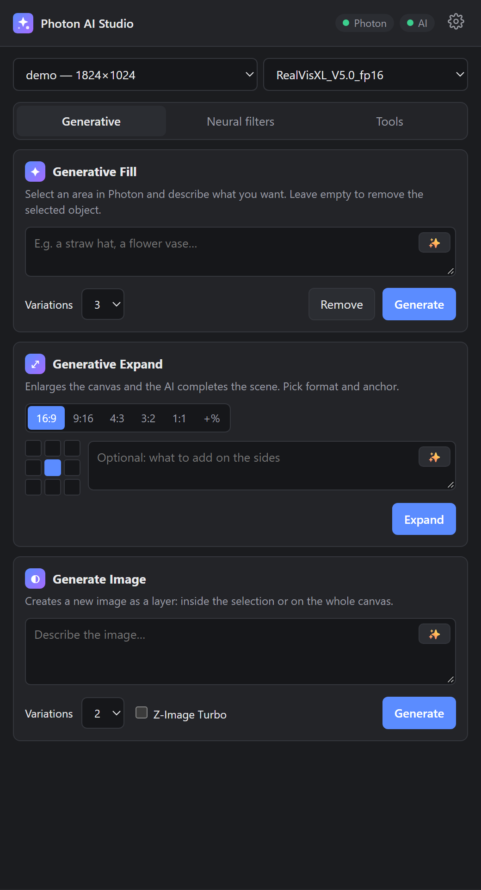
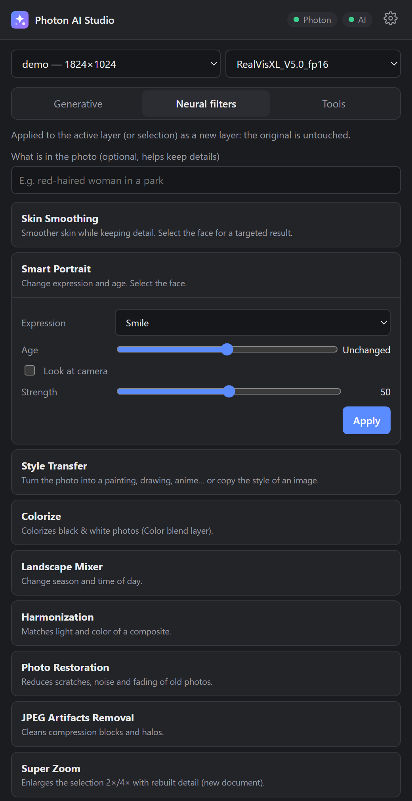
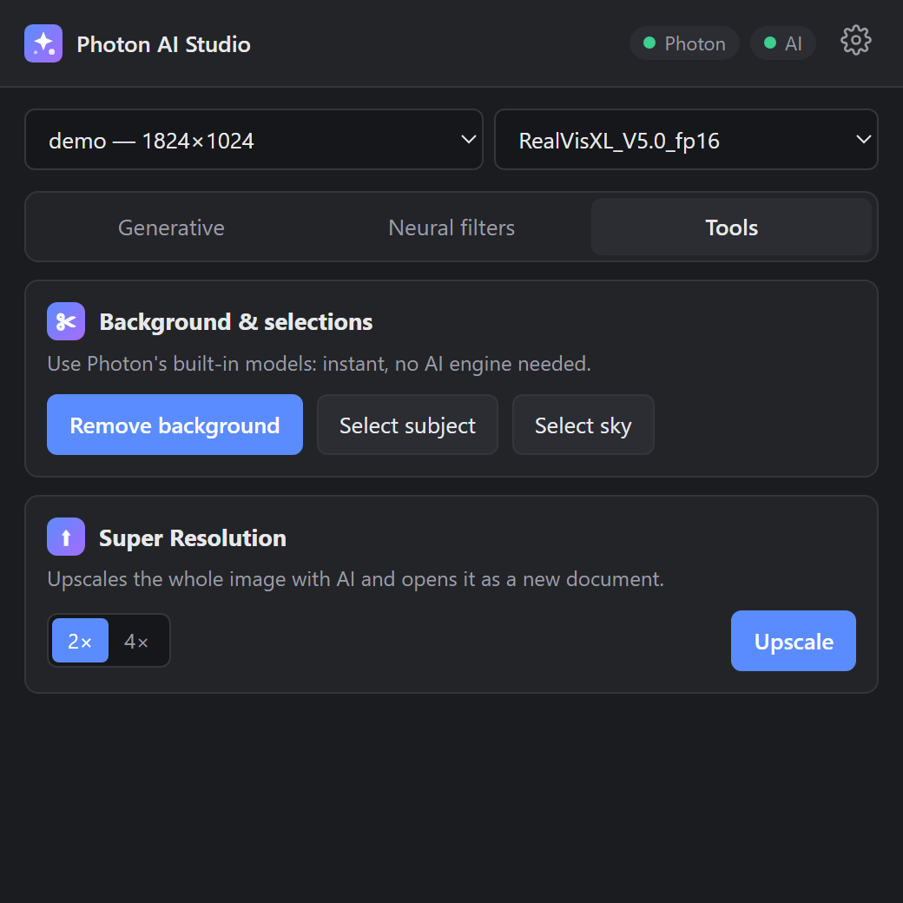
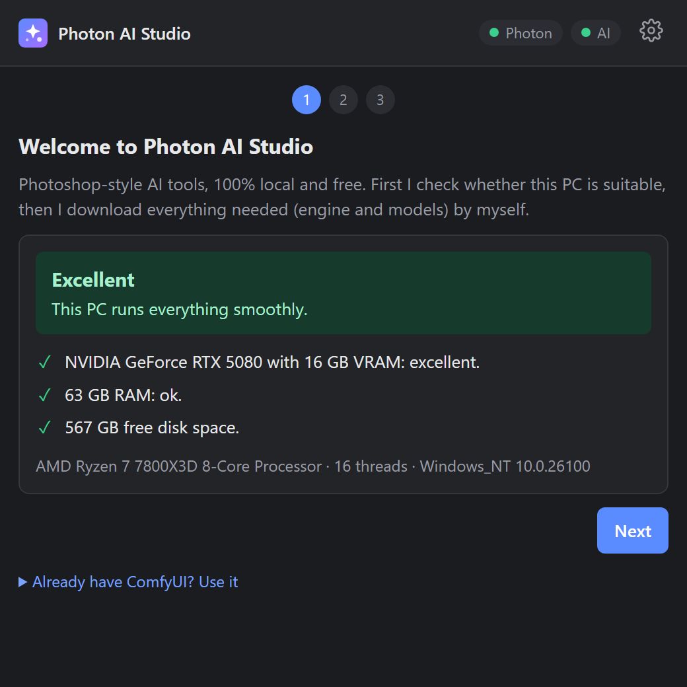
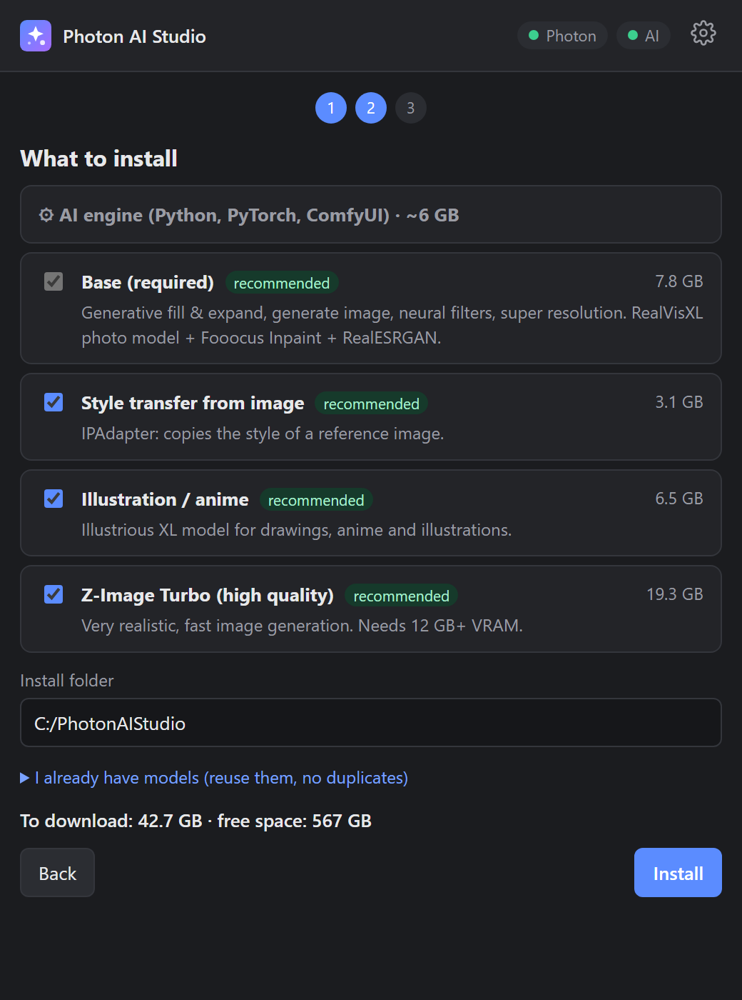

# Photon AI Studio

Photoshop-style AI tools for **[Photon Studio](https://tenzen.studio/photon/)**. They run 100% locally and are free.

| Tool | What it does |
|---|---|
| **Generative Fill** | Select an area, describe what you want and get up to 4 variations as masked layers. An empty prompt removes the selected object. |
| **Generative Expand** | Enlarges the canvas (16:9, 9:16, 4:3, 3:2, 1:1 or +%) with a 9-point anchor and completes the scene. |
| **Generate Image** | Creates a new layer inside the selection or on the whole canvas (SDXL or Z-Image Turbo). |
| **Remove Background / Select Subject / Select Sky** | Uses the models built into Photon, so it's instant. |
| **Super Resolution** | AI upscale 2×/4× (RealESRGAN), opened as a new document. |
| **Neural Filters** | Skin Smoothing, Smart Portrait (expression / age / gaze), Style Transfer (10 styles or a reference image), Colorize, Landscape Mixer, Harmonization, Photo Restoration, JPEG Artifacts Removal, Super Zoom, Depth Blur. |

Every result is added as a **new, non-destructive layer**. When there is a selection, the layer gets a soft layer mask and an automatic seam color match.

## Screenshots

<p align="center">
  
  
  
</p>

### Examples
All images below were made in Photon Studio with Photon AI Studio on a local GPU, using the default RealVisXL model.

**Generate Image**: *"photo of a cozy wooden cabin on the shore of a calm mountain lake at sunrise…"*


**Generative Fill**: select an area of water, then *"a small red wooden canoe floating on the calm lake"*

| Before | After |
|---|---|
|  |  |

**Generative Expand** from 3:2 to 16:9 (the canvas grows and the AI completes the forest and the lake)


**Neural Filters → Landscape Mixer** (Winter)


### Guided setup
<p align="center">
  
  
</p>

## How it works

Photon has no plugin API with network access (UXP/JSX scripts run in a sandbox), but it ships an **official automation CLI** (`photon`). Photon AI Studio is a companion app with a side panel:

```
Panel window ──► Photon AI Studio (local server) ──► photon CLI ──► Photon Studio
                              └──► AI engine (ComfyUI) on your PC
```

1. It reads the pixels of the layer or selection from Photon (`render`).
2. It runs a ComfyUI workflow (SDXL + Fooocus Inpaint, IPAdapter, RealESRGAN…).
3. It places the result back in Photon as a layer (`image.place` with a mask from the selection).

## Install (any PC)

1. Install and open **Photon Studio**. In *Settings → Agents*, enable/install the **CLI** if it isn't already.
2. Download the executable for your OS from the [latest release](https://github.com/Alex-ZeroGLabs/photon-ai-studio/releases/latest) and run it (Windows: `PhotonAIStudio-windows-x64.exe`, macOS: `PhotonAIStudio-macos-arm64`, Linux: `PhotonAIStudio-linux-x64`). Or run from source with `node src/server.js` (Node 22+).
3. On first run:
   - **Hardware check**: GPU/VRAM, RAM and disk give a rating of *Excellent / Good / Limited / Not recommended*, plus recommended packs.
   - **Pick model packs**: Base (required, ~8.4 GB), Style (IPAdapter, 3.4 GB), Anime (Illustrious XL, 6.9 GB), Z-Image Turbo (~19.4 GB, 12 GB+ VRAM).
   - **Automatic install** into a private folder, in this order: `uv` → Python 3.12 → PyTorch (CUDA 12.8 / Metal / CPU) → ComfyUI → nodes (Fooocus inpaint, IPAdapter) → models from Hugging Face. Downloads resume after interruptions.

Nothing needs to be installed by hand: no Python, ComfyUI or models are required beforehand.

### If you already have some of it
- **Existing ComfyUI**: choose *"Already have ComfyUI? Use it"* in the wizard, or Settings → Mode.
- **Reuse downloaded models**: point to an existing ComfyUI `models` folder; files already there are not downloaded again.
- **Ollama** (optional): if it is running, a ✨ button appears to translate and improve prompts.

### Folders
| | Windows | macOS | Linux |
|---|---|---|---|
| Engine & models | `%LOCALAPPDATA%\PhotonAIStudio` | `~/Library/Application Support/PhotonAIStudio` | `~/.local/share/photon-ai-studio` |
| Config | `~/.photon-ai-studio/config.json` | same | same |

## Recommended hardware
- **NVIDIA** with 8 GB+ VRAM (6 GB works in low-VRAM mode) and an up-to-date driver, or **Apple Silicon** with 16 GB+ (32 GB is better).
- 16 GB RAM and 25–50 GB of free disk space.
- Without a compatible GPU it still installs, but every operation takes minutes. The hardware check warns you about this.

## Run from source
Requires Node.js 22 or newer. There are no npm dependencies.
```
git clone https://github.com/Alex-ZeroGLabs/photon-ai-studio.git
cd photon-ai-studio
node src/server.js            # opens the panel window
node src/server.js --no-window --port=7788
```

## Project structure
```
src/
  server.js     HTTP server, job queue, API used by the panel
  photon.js     wrapper around the official `photon` automation CLI
  comfy.js      ComfyUI HTTP/WebSocket client
  workflows.js  ComfyUI graph builders (inpaint, outpaint, img2img, txt2img, upscale)
  features.js   the tools: fill, expand, generate, neural filters, super resolution…
  engine.js     self-installer: uv, Python, PyTorch, ComfyUI, nodes, model packs
  hardware.js   GPU / RAM / disk check and recommendations
  png.js        dependency-free PNG codec + seam color matching
public/         panel UI (HTML/CSS/JS, no framework)
build/build.js  single-executable builder (Node SEA)
```

## Build the executable
```
node build/build.js
```
Produces `dist/PhotonAIStudio(.exe)`: a single file with Node and the UI embedded (Node SEA). Build it on each target OS.
Publishing a GitHub Release runs [`.github/workflows/release.yml`](.github/workflows/release.yml), which builds the Windows, macOS and Linux executables and attaches them to the release automatically.
The executable is not code-signed. On first launch Windows SmartScreen may show "Windows protected your PC" (click *More info → Run anyway*), and macOS may require right-click → *Open*.

## Security & privacy
- The server listens on `127.0.0.1` only. It rejects requests from other websites by checking Host and Origin and requiring a custom header.
- Images never leave your PC. The only outbound connections are the install downloads (GitHub, Hugging Face, PyTorch, PyPI).

## Third-party software and models
Photon AI Studio downloads these components on the user's machine. They are not bundled in this repository, and each keeps its own license:

| Component | Source | License |
|---|---|---|
| ComfyUI | [comfyanonymous/ComfyUI](https://github.com/comfyanonymous/ComfyUI) | GPL-3.0 |
| uv | [astral-sh/uv](https://github.com/astral-sh/uv) | MIT / Apache-2.0 |
| PyTorch | [pytorch.org](https://pytorch.org) | BSD-3-Clause |
| comfyui-inpaint-nodes | [Acly/comfyui-inpaint-nodes](https://github.com/Acly/comfyui-inpaint-nodes) | GPL-3.0 |
| ComfyUI_IPAdapter_plus | [cubiq/ComfyUI_IPAdapter_plus](https://github.com/cubiq/ComfyUI_IPAdapter_plus) | GPL-3.0 |
| RealVisXL V5.0 | [SG161222/RealVisXL_V5.0](https://huggingface.co/SG161222/RealVisXL_V5.0) | see model card |
| Fooocus Inpaint | [lllyasviel/fooocus_inpaint](https://huggingface.co/lllyasviel/fooocus_inpaint) | see model card |
| Real-ESRGAN | [xinntao/Real-ESRGAN](https://github.com/xinntao/Real-ESRGAN) | BSD-3-Clause |
| IP-Adapter | [h94/IP-Adapter](https://huggingface.co/h94/IP-Adapter) | Apache-2.0 |
| Illustrious XL v0.1 | [OnomaAIResearch/Illustrious-xl-early-release-v0](https://huggingface.co/OnomaAIResearch/Illustrious-xl-early-release-v0) | see model card |
| Z-Image Turbo | [Comfy-Org/z_image_turbo](https://huggingface.co/Comfy-Org/z_image_turbo) | see model card |

Check each model card before any commercial use of generated images.

## Disclaimer
Photon AI Studio is an independent project. It is not affiliated with or endorsed by Tenzen (makers of Photon Studio) or Adobe. "Photoshop" is a trademark of Adobe Inc.; it is mentioned only to describe comparable features.

## License
[MIT](LICENSE)
